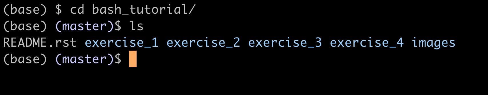
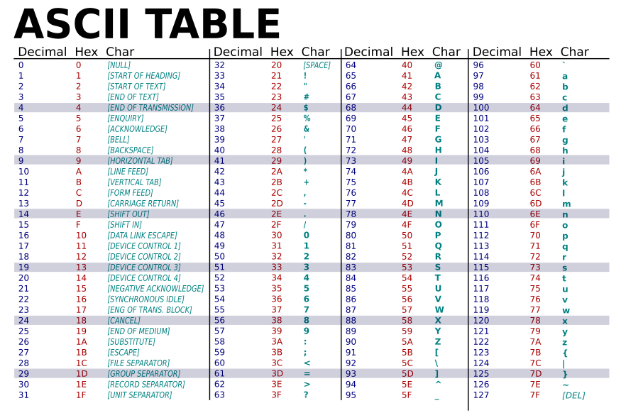

# Command Line Tutorial

> [!NOTE]
> This tutorial is adapted from [The Bash Command Line](https://github.com/krother/bash_tutorial) by Dr. Kristian Rother, published under the [CC BY-SA 4.0](https://creativecommons.org/licenses/by-sa/4.0/) licence. See [Credits and Licence](README.md#credits-and-licence) in the README.

This tutorial introduces the **bash command line**, an interactive terminal native to most Linux distributions as well as macOS. In the command line, you enter commands to navigate directories, manipulate files, and run programs. You will frequently use it to **manage your project environment.**

If you have no previous experience with Unix-like systems, or only know a few commands but would like to know more, this tutorial is a good place to start.

> [!TIP]
> The tutorial works in Bash on Linux, Terminal on macOS, and Git Bash on Windows, provided `uv` is installed. You set it up during onboarding.

> **A note on terminology**
>
> While there are subtle distinctions in their definitions, we can use the
> terms "terminal" and "command line" interchangeably in this course. More
> technically, the different terminal programs used in this course, depending
> on the operating system, are part of the
> ["Unix Shell"](https://en.wikipedia.org/wiki/Unix_shell).
>
> The Unix Shell provides the command line interface for Unix-like operating
> systems, primarily **Linux** and **macOS** in this context. This course
> focuses on **Bash**, since Bash is the default shell for Linux. Bash was also
> the default shell for macOS until around 2019, when it was replaced by
> **Zsh**. The slight difference between Bash and Zsh is negligible for this
> course, so we can treat them the same.
>
> Most cloud computing runs on Linux servers, and much of the data science
> software used in this course installs more easily on Linux and macOS. The
> data science community has also gravitated toward Linux as its preferred
> operating system. Since macOS is in the same family and uses the same command
> line language, transitioning from macOS to Linux is nearly seamless.
>
> Windows users who are not using Ubuntu alongside Windows will not have the
> same command line experience by default. Although we do not use the Windows
> command line, also known as **cmd.exe**, **cmd**, or the **Command Prompt**,
> a tool such as [Git Bash](https://gitforwindows.org/) allows you to run Bash
> commands on a Windows machine.

## When You Get Stuck

Use the [Unix command cheat sheet](Unix-Command-Cheatsheet.pdf) while working
through the exercises.

If you cannot find what you need there, use Google to search for the command or
error message. If you are still stuck, ask an AI assistant to explain the
command or suggest a next step. If you are still blocked after that, ask for
assistance.

## Goal

In this tutorial, you will be looking for a 17-character solution:

```text
_ _ _ _ _ _ _ _ _ _ _ _ _ _ _ _ _
```

All characters are hidden in the exercises below. Work through exercises 1 to 6
and collect the characters in order to find the full word.

## Preparations

All exercises can be solved using a **Unix-like terminal** (including MacOS terminal)
as well as **Git Bash** for Windows.

- clone or download this repository to your computer.
- open a terminal and navigate into the repository directory.
- navigate into the `bash_tutorial/` directory using `cd bash_tutorial/`.
- when you type ``ls`` it should look like this:



## 1. Directories and Files

---

### Navigating Directories

The **first character** is hidden in a file somewhere in the ``exercise_1/``
directory tree. Use the commands

```bash
cd <directory_name>
```

to move from one directory to the next. (do not type the pointy brackets,
just insert the directory name after the ``cd`` command.)

Once you've changed to a new directory, you can use

```bash
ls
```

list the directory's contents. Look through subdirectories
until you find one with the name ``solution_1.1`` and list its contents.
If you went to a wrong directory, you can go back one level by typing:

```bash
cd ..
```

or go back to your home folder:

```bash
cd 
```

or

```bash
cd ~
```

### Show a Hidden File

Some files are not visible immediately. To see them, you need the
command

```bash
ls -a 
```

The **second character** is in the same directory as the first one, but
in a hidden file.

### Execute a Program

Use `cd ..` to go back to the directory ``exercise_1/directoryB/``. When
listing its contents, you should see a **shell script** file called ``program.sh``.
To find the **third character**, you need to execute the program.
In bash, this can be done with the `source` command:

```bash
source program.sh
```

Hint:

   *When typing names of directories or files,
   press ``[TAB]`` after the first few characters.
   Unix tries to guess what you are typing.*

### Find Out How Big a File is

Go to the folder ``exercise_1/directoryC/``. To find **the fourth
character**, you need to find out how big the text file in the directory
is. This is done with the command

```bash
ls -l
```

In the table the command produces, you will find the file size (in bytes)
next to the date/time when the file was last modified.

Look up the file size (decimal value) in the
[Table of printable ASCII characters](https://en.wikipedia.org/wiki/ASCII#Printable_characters)
to obtain the corresponding character. For example, if the file size is 65 bytes,
then the fourth character would be the letter `A`.



Table of ASCII characters, Public Domain

Warning:

   >We've noticed in the past that Windows users, get a slightly different number
   than the Linux / Mac users, presumably due to a small difference in how the Windows OS treats line breaks. So for this exercise, we'll give you the answer --until we eventually phase out this question of the tutorial and
   replace it with something that works the same way on all computers. Please pardon the inconvenience!

## 2. Edit Text Files

---

Please use ``cd ..`` to go back to the top directory of the tutorial
material. Then, change to the directory ``exercise_2``.

### See What's in a Text File

In the directory *exercise\_2/*, you will find a text file
*solution\_2.1.txt*. The **fifth character** is inside that file. To see
its contents, use the command

```bash
less <filename>
```

Hint:

Press ``q`` to leave the display mode.

### Edit Text Files

To get **character number six**, you will need to create a text file in
the ``exercise_2`` directory. On most Unix-like systems, you can do this
using the *nano* editor. To start using the nano editor directly, you can simply
run the ``nano`` command, or you can simultaneously create a new file:

```bash
nano <filename>
```

After typing in something in the body of the file (e.g. the letters you have
found so far), you will need to save and exit the program. You'll notice options
at the bottom of the screen referencing the keyboard shortcuts needed for
interacting the the program. (Note that the ``^`` symbol means the *control key*).

The **sixth character** is the letter next to the control key for
saving, or "writing out" a file in *nano*.

Hint:
If you want to know more about a particular command, type `man <command>`.
You get shown a help page that you can leave by pressing 'q'.

## 3. Copy and Remove Files

---

Please navigate inside the ``exercise_3`` directory.

### Create a Directory and Copy a File to it

To find **characters seven and eight**, create a directory named ``solution/``
and copy the files from the ``part1/`` and ``part2/`` directories into it.

For creating directories, use the command:

```bash
mkdir <directory name>
```

To copy the contents of the ``part1/`` and ``part2/`` directories into
``solution/``, run the commands:

```bash
cp part1/* solution/
cp part2/* solution/
```

Type ``ls -l solution/*`` to points towards the solution.

*Hint*:
*What does the ``*`` symbol mean?*

### Removing Files

In the ``data`` directory, all files with an ``Y`` in their name need to be deleted.

To remove a file, use the command:

```bash
rm <filename>
```

There are many such files to be deleted in the *data* directory. To
remove more than one file at once, you can use ``*`` symbol as a wildcard:

e.g. ``rm ju*`` will delete all of ``junk.txt, juniper.txt`` and
``june.docx``.

To get **characters nine and ten**, look at the files that remain after
deleting those that contain a ``Y``.

*Hint*:

To remove an empty directory, you can use

```bash
rmdir <directory name>
```

The command

```bash

rm -r <directory name>
```

deletes a directory and everything in it.

Warning:

   On Unix, it is not possible to un-delete files!

   This makes removing files with the ``*`` symbol **very** dangerous,
   because you could wipe out everything
   with a single command
   (e.g. if you type the wrong directory by accident).
   Backups become an even better idea after learning this command.

## 4. Comparing Files and Running Python

---

Please go to the directory ``exercise_4``.

### Compare Text Files

The first ten characters came from exercises 1 to 3. Exercise 4 contains the
next three characters.

Start by comparing the two similar text files:

```bash
diff ai.txt artificial_intelligence.txt
```

The difference points to **character eleven**.

Then inspect and search the remaining text files. Useful commands here are:

```bash
less <filename>
grep <search term> <filename>
grep <search term> *
```

The quote about parameters and the quote attribution give clues for
**characters twelve and thirteen**.

### Running Python Scripts

You can also run the Python script ``file.py`` to confirm one of the characters.
Run it with `uv`, which starts Python for you and then runs the script:

```bash
uv run file.py
```

> [!NOTE]
> `python3 file.py` works too, if Python 3 is installed directly on your computer. In this course we use `uv run`, the same way you will run code in every project. [Python Environments with uv](03_python_environments_with_uv.md) explains what it does.

## 5. Unwrapping Archives

---

Please go to the directory ``exercise_5``.

The file ``wrapped.zip`` contains another archive inside it. To find
**characters fourteen and fifteen**, unpack each layer and inspect the final
solution file.

First unzip the outer archive:

```bash
unzip wrapped.zip
```

Then inspect and extract the tar archive:

```bash
tar -tf wrapped.tar
tar -xf wrapped.tar
```

The extracted solution is compressed with gzip. Decompress it with:

```bash
gunzip solution/solution.txt.gz
```

Now read the solution file:

```bash
less solution/solution.txt
```

## 6. Permissions and Pipes

---

Please go to the directory ``exercise_6``.

The final two characters are hidden in a shell script named
``permissions.sh``. First inspect the script, without running it:

```bash
less permissions.sh
```

### Run a Script That Is Not Allowed to Run

Try to run the script directly:

```bash
./permissions.sh
```

The terminal answers `Permission denied`. Every file has **permissions** that say who may read it, change it, and run it, and this script is not allowed to run yet.

### Read and Change Permissions

List the file with its permissions:

```bash
ls -l permissions.sh
```

The first column starts with `-rw-r--r--`. Read it in groups of three after the first character: `rw-` means you, the owner, may **r**ead and **w**rite the file, but there is no `x`, so you may not e**x**ecute it. The next two groups are the permissions for your group and for everyone else.

Give yourself permission to run the script with `chmod`, then check the permissions again:

```bash
chmod +x permissions.sh
ls -l permissions.sh
```

The first column now reads `-rwxr-xr-x`: the `x` means the file can be executed. Run it:

```bash
./permissions.sh
```

> [!NOTE]
> On Windows, Git Bash handles permissions differently, so you may not see `Permission denied` and `chmod` may not change the listing. If so, run the script with `source permissions.sh` instead.

### Pipes

The script uses a **pipe**, the `|` character, to send the output of one command into the next: `echo` prints a hidden code, and `cut` picks single pieces out of it. The output gives **characters sixteen and seventeen**.

When you have collected all 17 characters, combine them in order to find the
full word.

---

## Recap Questions

Try to answer each question on your own. Then compare your answers with the
[answer key](more_challenges_solution/README.md#recap-questions-answer-key) in the solutions folder,
which also explains each one.

- What does `cd ..` do?
- What is the difference between `cd home/` and `cd /home`?
- Explain the output of `ls -la`.
- How can you repeat the last command you entered?
- When does TAB completion work?
- How can you look up the documentation of bash commands?

When you have finished, continue with [Python Environments with uv](03_python_environments_with_uv.md). If you want more practice first, try the optional [More Challenges](02_more_challenges.md).
