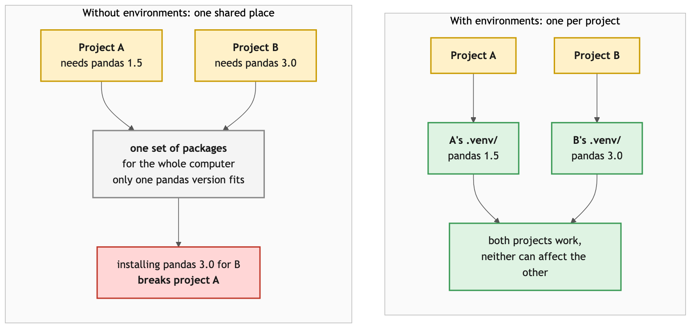
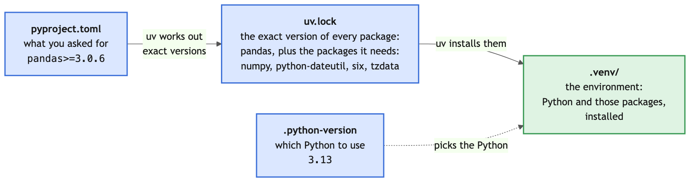
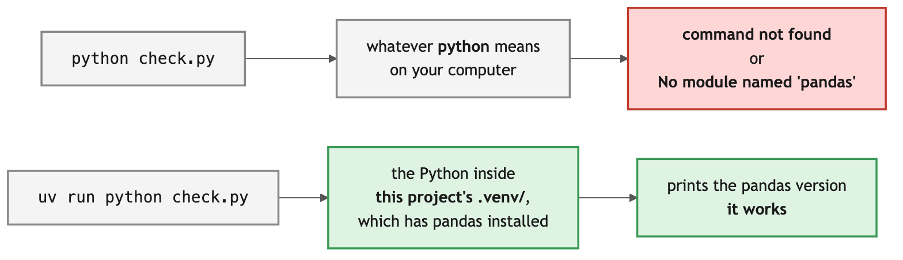
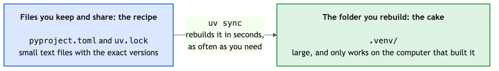

# Python Environments with uv

Every repository in this bootcamp has a `pyproject.toml` and a `uv.lock`, and every one of
them expects you to run `uv sync` before you start. You will type that command most days for
the next weeks.

This exercise is so that you know what it does.

## Objectives

At the end of this exercise you should be able to:

- Create a project with `uv` and add a dependency to it.
- Locate what `pyproject.toml`, `uv.lock`, `.python-version` and `.venv/` each hold.
- Run code inside a project's environment with `uv run`.
- Identify which project files you keep and share, and rebuild a deleted environment from the lockfile with `uv sync`.

## The Problem Environments Solve

Imagine two projects on your machine. One needs pandas 1.5, the other needs pandas 3.0.
If Python installs packages in one shared place, the second project breaks the first.

A **virtual environment** is a private folder of installed packages belonging to one project.
Each project gets its own, so they cannot interfere. `uv` is the tool that creates and fills
those folders for us.



## 1. Make a Project

---

> [!IMPORTANT]
> Do this exercise **outside** this repository, for example in your home folder, so your
> practice project stays separate from the course files.

1. Go to your home folder with `cd ~`, then make a folder called `env-practice` and move into it.
2. Before running a command for the first time, read what it does. Run:
   ```bash
   uv init --help
   ```
   Read the first line and the list of options. What does `uv init` do? Which option would stop
   it from creating a `README.md`? Which option decides whether it starts a git repository?
3. Now create the project. Use the option you found in the help to tell `uv` **not** to start
   a git repository, because git has its own day in this course:
   ```bash
   uv init --vcs none
   ```
4. List the files that appeared, including hidden ones. What did `uv init` create?
5. Open `pyproject.toml` and read it. Which parts describe your project, and which describe
   what it depends on?
6. Look at `.python-version`. What is it for?
7. There is no `.venv/` yet, and no `uv.lock`. Note that, then continue.

## 2. Add a Dependency

---

1. Run `uv add pandas`.
2. Read what uv printed. It created an environment, resolved the dependencies, and installed
   them.
3. Look at `pyproject.toml` again. What changed?
4. There is now a `uv.lock`. Open it and skim. Roughly how many packages are listed, and why
   is that more than the one you asked for?
5. Look inside `.venv/`. **This is the environment.** It is a folder of installed packages
    and nothing more.

How the files you just looked at fit together. `uv add pandas` did every step at once: it edited `pyproject.toml`, updated `uv.lock`, and installed the packages into `.venv/`.



## 3. Run Code in the Environment

---

1. Create `check.py` containing:
    ```python
    import pandas as pd

    print(pd.__version__)
    ```
2. Run it with plain `python check.py`. Depending on your computer, you see either
    `command not found` or `ModuleNotFoundError: No module named 'pandas'`. What does each
    one tell you?
3. Now run `uv run python check.py`. Why does this one work?
4. Run `uv add requests`, then `uv remove requests`. Watch `pyproject.toml` and `uv.lock`
    both times.

Why plain `python` failed and `uv run` worked:



## 4. Delete and Rebuild the Environment

---

This is the part that matters, because it is what `uv sync` is for.

1. Delete the whole `.venv/` folder.
2. Run `uv run python check.py` again. Read what uv does before your code runs.
3. Delete `.venv/` once more, then run `uv sync` and look in the folder.

You have just done, by hand, what every repository in this course asks of you on the first
page of its README. `uv sync` reads `uv.lock` and rebuilds the exact environment it describes.

## 5. What You Keep and What You Rebuild

---

You have now seen that your project is made of two kinds of files.

- **Files you keep:** `pyproject.toml` and `uv.lock`. They are small text files that describe
  exactly which packages the project needs. They are what you share with other people, and
  what every course repository gives you.
- **The folder you rebuild:** `.venv/`. It is large, it only works on the computer that built
  it, and `uv sync` can recreate it from `uv.lock` at any time. You never share it, and you
  never need to back it up.

**Your turn:** in your own words, write one sentence on why you keep `uv.lock`, and one sentence
on why you never share `.venv/`. Then read the comparison below.

Think of `uv.lock` as a **recipe** and `.venv/` as the **cake**. You share the recipe, which is
short and exact, so everyone who follows it gets the same result. You do not post the cake:
anyone can bake it again from the recipe in seconds.



> [!NOTE]
> On the version control day you will learn how git is told to leave `.venv/` out of a
> repository, in the exercise on ignoring files.

## Check Your Understanding

1. You send your project folder to a colleague, without `.venv/`. Which file means they get
   exactly your package versions rather than merely compatible ones?

   <details>
   <summary>Show answer</summary>

   `uv.lock`. `pyproject.toml` records what you asked for, often as a range like "pandas 3 or newer", which can resolve to different versions on different days. The lockfile records the exact version of every package that was actually installed, including ones you never named directly, so `uv sync` rebuilds an identical environment.

   </details>
2. `python check.py` failed but `uv run python check.py` worked. What is `uv run` doing?

   <details>
   <summary>Show answer</summary>

   `uv run` executes the command inside the project's environment, using the Python and packages in `.venv/` rather than whatever `python` happens to mean in your shell. Plain `python` either does not exist on your computer (many Macs only have `python3`), or it is a Python installation that does not have pandas installed. `uv run` also checks the environment is up to date with the lockfile first, and fixes it if not.

   </details>
3. You deleted `.venv/` by accident. How much work have you lost?

   <details>
   <summary>Show answer</summary>

   None. The environment is built entirely from `pyproject.toml` and `uv.lock`, both of which you keep, so `uv sync` recreates it in seconds. That is why `.venv/` is safe to delete and why it is never shared: it is always rebuilt from those two files, never written by you.

   </details>
4. Why does the course never give you a `.venv/` folder with its projects?

   <details>
   <summary>Show answer</summary>

   Because it is large, it only works on the computer that built it, and it can always be rebuilt. It can contain thousands of files, and packages built for one operating system do not work on another, so sharing it would make every project huge and still not work for a classmate. Each course project gives you `uv.lock` instead, the small exact recipe, and you build your own `.venv/` from it with `uv sync`.

   </details>
5. You are about to start work on a course project you have just copied to your computer.
   What is the first command you run inside its folder?

   <details>
   <summary>Show answer</summary>

   `uv sync`. It reads `uv.lock` and builds the environment the project expects, which is why every README in this course lists it as a setup step. After that, run things with `uv run` so they use that environment.

   </details>

## Useful Commands

- `uv init` start a new project here, `uv init --vcs none` without starting a git repository
- `uv add <package>` add a dependency and install it
- `uv remove <package>` remove one
- `uv sync` build the environment described by `uv.lock`
- `uv run <command>` run a command inside the project environment
- `uv run python <file.py>` run a script inside it
- `uv tree` see what depends on what
